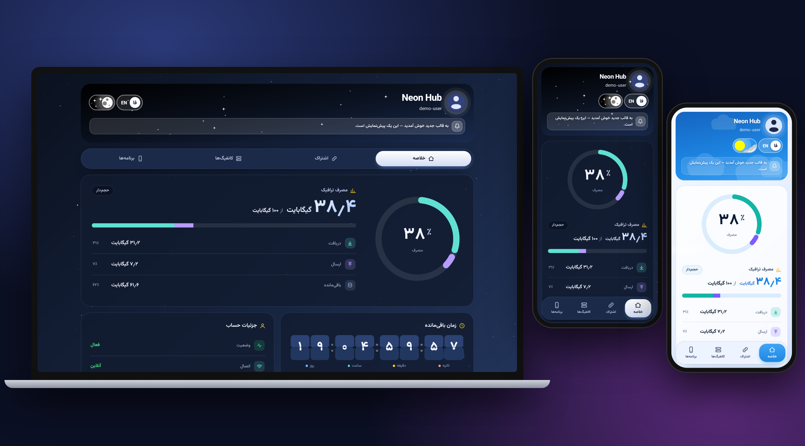

<div dir="rtl" align="right">

# 3x-hub

قالب اختصاصی، مدرن و چندصفحه‌ای (Tabbed) برای صفحه اشتراک پنل **3x-ui** (سازگار با نسخه‌های **v3.3.0** تا جدیدترین نسخه **v3.11.x+**).

**3x-hub** یک صفحه اشتراک حرفه‌ای، سوپر ریسپانسیو و دو زبانه (فارسی و انگلیسی) برای پنل قدرتمند **3x-ui** است که با الهام از مدرن‌ترین استانداردهای طراحی وب و انیمیشن‌های مینیمال پیاده‌سازی شده است.

---

## پیش‌نمایش قالب



---

## ویژگی‌ها و قابلیت‌های برجسته

- **چیدمان تب‌بندی شده چندصفحه‌ای (Tabbed Pages):** تفکیک محتوا به صفحات مجزا (وضعیت اشتراک، لیست کانفیگ‌ها، اتصال سریع و راهنمای دانلود برنامه‌ها) با انیمیشن‌های روان جا‌به‌جایی.
- **ناوبری موبایل ارگونومیک (Mobile Bottom Navigation Dock):** در صفحه‌نمایش‌های موبایل و ابعاد کوچک، دکمه‌های تغییر صفحه به پایین نمایشگر منتقل شده و به صورت نوار شناور شیشه‌ای (Glassmorphism) قرار می‌گیرند تا دسترسی به آن‌ها با یک دست بسیار ساده باشد.
- **کلید اختصاصی تغییر تم شب و روز (Day / Night Switch):** طراحی چشم‌نواز الهام‌گرفته از آرت‌ورک‌های کیهانی Riccardo Rapelli همراه با انیمیشن خورشید، ماه، ابرها، اشعه‌ها و ستاره‌ها.
- **انیمیشن‌های سیال تغییر زبان (FLIP Animation):** امکان سوییچ سریع میان زبان‌های فارسی (RTL) و انگلیسی (LTR) با انیمیشن ترنزیشن حرکتی برای تمامی المان‌ها و متون صفحه بدون نیاز به رفرش مرورگر.
- **به‌روزرسانی خودکار و زنده (Live Polling):** فراخوانی خودکار اطلاعات مصرف و ترافیک از API داخلی پنل (`?format=info`) هر ۱۵ ثانیه بدون بارگذاری مجدد صفحه.
- **نمایش وضعیت برخط زنده (Live Online Status):** نمایش وضعیت اتصال کاربر (Online / Offline)، آخرین زمان اتصال، و نشانگر اختصاصی وضعیت شبکه هنگام قطع یا وصل شدن اینترنت.
- **گیج دایره‌ای مدرن و آنالیز ترافیک:** نمایش گرافیکی درصد حجم مصرف‌شده به همراه نمایش تفکیکی دانلود، آپلود، ترافیک باقیمانده و سقف کل.
- **شمارش معکوس دقیق زمان انقضا:** تایمر هوشمند زمان باقیمانده اشتراک، هماهنگ با تقویم انتخابی پنل (شمسی Jalali و میلادی Gregorian) و پشتیبانی هوشمند از کانفیگ‌های On-Hold (شروع زمان پس از اولین اتصال).
- **مدیریت پیشرفته کانفیگ‌ها:** لیست هوشمند کانفیگ‌ها با قابلیت جستجوی زنده، شناسایی خودکار پروتکل‌ها (VLESS, VMess, Trojan, Shadowsocks, Hysteria 2, TUIC, WireGuard) و دکمه‌های کپی تکی، کپی یکجای همه و کد QR اختصاصی.
- **دکمه‌های اتصال سریع با یک کلیک:** اتصال مستقیم به محبوب‌ترین کلاینت‌ها:
  - **Android:** v2rayNG, Happ, Sing-box, Clash Meta
  - **iOS:** Shadowrocket, Streisand, Happ, Sing-box
  - **Desktop:** Clash Meta / Verge, Sing-box, Hiddify
- **دایرکتوری دانلود نرم‌افزارها:** لینک‌های مستقیم و تفکیک‌شده دانلود آخرین نسخه‌های نرم‌افزارهای کلاینت برای سیستم‌عامل‌های Android، iOS، Windows و macOS.
- **فوق‌العاده سبک، مدرن و تک‌فایلی:** بدون نیاز به هیچ ابزار بیلد، وابستگی‌های سنگین خارجی یا پکیج‌های حجیم؛ کاملاً بهینه‌سازی شده برای نهایت سرعت بارگذاری.

---

## نصب سریع

برای نصب یا آپدیت خودکار قالب روی سرور، دستور زیر را در ترمینال سرور خود (با دسترسی root یا sudo) اجرا کنید:

```bash
bash <(curl -fsSL https://raw.githubusercontent.com/ramin-mahmoodi/3x-hub/main/install.sh)
```

فایل قالب در مسیر زیر قرار می‌گیرد:

```text
/etc/x-ui/sub/sub.html
```

---

## مرحله مهم: فعال‌سازی قالب در پنل 3x-ui

در نسخه‌های جدید 3x-ui، پنل به طور پیش‌فرض صفحه ری‌اکتی داخلی خود را نشان می‌دهد و برای اعمال قالب سفارشی، کافیست مسیر پوشه قالب را به پنل معرفی کنید:

1. وارد پنل مدیریت **3x-ui** خود شوید.
2. از منوی کناری به بخش **تنظیمات پنل (Panel Settings)** یا **Settings** بروید.
3. زبانه **اشتراک (Subscription)** و سپس بخش **اطلاعات (Information)** را باز کنید.
4. در فیلد **Sub Theme Directory** (پوشه تم اشتراک)، مسیر زیر را وارد کنید:
   ```text
   /etc/x-ui/sub
   ```
5. دکمه **ذخیره (Save)** را بزنید.
6. پنل را ری‌استارت کنید:
   ```bash
   x-ui restart
   ```

> **نکته برای کاربران داکر (Docker):**  
> اگر پنل 3x-ui را داخل کانتینر داکر اجرا کرده‌اید، مطمئن شوید پوشه `/etc/x-ui/sub` روی هاست را در فایل `docker-compose.yml` یا دستور `docker run` به کانتینر متصل (mount) کرده‌اید (مثلاً `-v /etc/x-ui/sub:/etc/x-ui/sub:ro`) و سپس همان مسیر داخلی را در فیلد `Sub Theme Directory` قرار دهید.

---

## نصب دستی

اگر تمایل دارید فایل قالب را بدون اسکریپت و به صورت دستی دریافت کنید:

```bash
mkdir -p /etc/x-ui/sub
curl -fsSL https://raw.githubusercontent.com/ramin-mahmoodi/3x-hub/main/sub.html -o /etc/x-ui/sub/sub.html
chmod 644 /etc/x-ui/sub/sub.html
```

سپس مراحل فعال‌سازی را در پنل انجام دهید.

---

## به‌روزرسانی

برای دریافت آخرین تغییرات و بهینه‌سازی‌های قالب، کافیست مجدداً دستور نصب سریع را اجرا کنید:

```bash
bash <(curl -fsSL https://raw.githubusercontent.com/ramin-mahmoodi/3x-hub/main/install.sh)
```

---

## بازگردانی به قالب پیش‌فرض پنل

اگر زمانی خواستید به صفحه اشتراک پیش‌فرض داخلی 3x-ui بازگردید:
کافیست در تنظیمات پنل (**Settings → Subscription → Information**)، فیلد **Sub Theme Directory** را کاملاً خالی کرده و ذخیره کنید.

---

## ساختار فایل‌های مخزن

```text
3x-hub/
├── README.md        # راهنما و مستندات کامل پروژه
├── install.sh       # اسکریپت نصب و آپدیت خودکار
├── preview.png      # تصویر پیش‌نمایش قالب
└── sub.html         # قالب کامل صفحه اشتراک
```

---

## سازگاری

```text
3x-ui v3.3.0+ / v3.10.x / v3.11.x+
```

</div>
