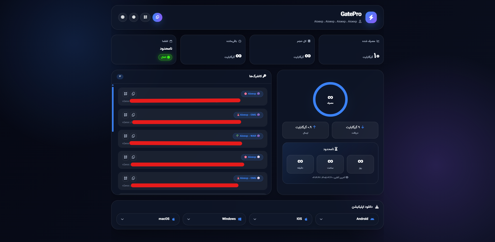
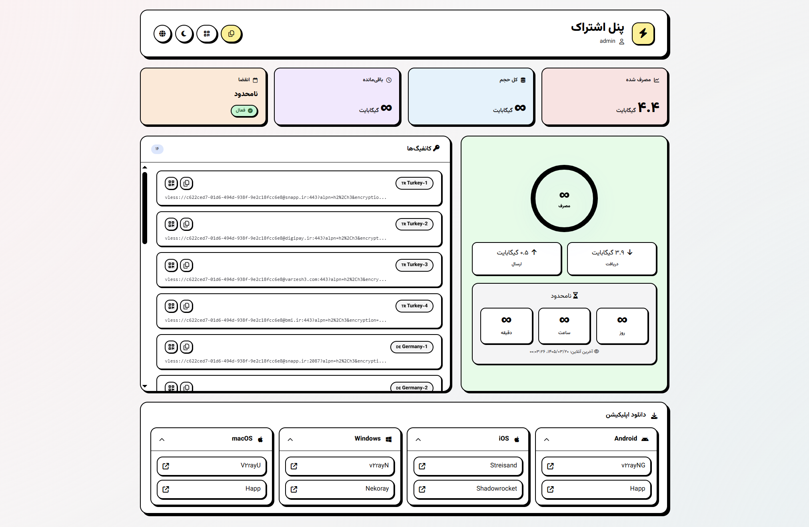

<div dir="rtl" align="right">

# 3x-hub

قالب اختصاصی و مدرن برای صفحه اشتراک پنل **3x-ui** (سازگار با نسخه‌های **v3.3.0** تا جدیدترین نسخه **v3.11.x+**).

**3x-hub** یک صفحه اشتراک کاستوم، مدرن، ریسپانسیو و دو زبانه (فارسی و انگلیسی) برای پنل محبوب **3x-ui** است که امکانات پیشرفته و کاملی را برای کاربران و کلاینت‌ها فراهم می‌کند.

## پیش‌نمایش قالب

### تم تاریک


### تم روشن


## ویژگی‌ها

- طراحی چشم‌نواز، مدرن و کاملاً ریسپانسیو برای انواع گوشی‌ها، تبلت و دسکتاپ
- پشتیبانی کامل از زبان‌های فارسی و انگلیسی (با قابلیت تغییر زبان)
- حالت تم تاریک و شبانه شکیل با استایل کیهانی
- نمایش وضعیت برخط بودن زنده کاربر (**Live Online / Offline Status**)
- به‌روزرسانی زنده و لحظه‌ای مصرف ترافیک بدون نیاز به رفرش صفحه (از طریق API رسمی `?format=info`)
- نمایش حجم مصرف‌شده (دانلود و آپلود)، حجم کل، حجم باقیمانده و درصد مصرف گرافیکی
- شمارش معکوس زمان انقضا و پشتیبانی هوشمند از کانفیگ‌های «انقضا پس از اولین اتصال»
- هماهنگی کامل با تنظیم تقویم پنل (شمسی Jalali و میلادی Gregorian)
- نمایش دوره بروزرسانی خودکار کلاینت (`subUpdates`)
- نمایش اعلان‌های مدیریت پنل (`subAnnounce`)
- دکمه‌های اتصال مستقیم با یک کلیک به ۱۰ نرم‌افزار پرطرفدار:
  - **Android:** v2rayNG, V2Box, Happ, Hiddify, Sing-box, Incy, V2RayTun, Clash/Mihomo
  - **iOS:** Shadowrocket, Streisand, V2Box, Happ, Incy, V2RayTun, Sing-box
  - **Desktop:** Clash / Mihomo, Sing-box, Hiddify
- شناسایی هوشمند پروتکل‌ها و نمایش نشان اختصاصی:
  - VLESS, VMess, Trojan, Shadowsocks
  - Hysteria 2, TUIC v5
  - AmneziaWG, WireGuard, MTProto
- کپی سریع لینک سابسکریپشن، تمام کانفیگ‌ها، یا هر کانفیگ به صورت مجزا
- نمایش QR Code اختصاصی برای لینک ساب و تک‌تک کانفیگ‌ها
- لینک‌های دانلود آخرین نسخه‌های نرم‌افزارهای اتصال برای اندروید، آی‌اواس، ویندوز و مک

---

## نصب سریع

برای دانلود و قرار دادن قالب روی سرور، دستور زیر را در ترمینال سرور خود (با دسترسی root یا sudo) اجرا کنید:

```bash
bash <(curl -fsSL https://raw.githubusercontent.com/ramin-mahmoodi/3x-hub/main/install.sh)
```

فایل صفحه اشتراک در مسیر زیر قرار می‌گیرد:

```bash
/etc/x-ui/sub/sub.html
```

---

## مرحله مهم: فعال‌سازی قالب در پنل 3x-ui

در نسخه‌های جدید 3x-ui، پنل به طور پیش‌فرض صفحه ری‌اکتی داخلی خود را نشان می‌دهد و برای اعمال قالب سفارشی، باید مسیر پوشه قالب را به پنل معرفی کنید:

1. وارد پنل مدیریت **3x-ui** خود شوید.
2. از منوی کناری به بخش **تنظیمات پنل (Panel Settings)** یا **Settings** بروید.
3. زبانه **اشتراک (Subscription)** و سپس بخش **اطلاعات (Information)** را باز کنید.
4. در فیلد **Sub Theme Directory** (پوشه تم اشتراک)، مسیر زیر را وارد کنید:
   ```text
   /etc/x-ui/sub
   ```
5. دکمه **ذخیره (Save)** را بزنید.
6. پنل را ری‌استارت کنید:
   ```bash
   x-ui restart
   ```

> **نکته برای کاربران داکر (Docker):**  
> اگر پنل 3x-ui را داخل کانتینر داکر اجرا کرده‌اید، مطمئن شوید پوشه `/etc/x-ui/sub` روی هاست را در فایل `docker-compose.yml` یا دستور `docker run` به کانتینر mount کرده‌اید (مثلاً `-v /etc/x-ui/sub:/etc/x-ui/sub:ro`) و سپس همان مسیر داخلی را در فیلد `Sub Theme Directory` قرار دهید.

---

## نصب دستی

اگر تمایل دارید قالب را به صورت دستی دانلود کنید:

```bash
mkdir -p /etc/x-ui/sub
curl -fsSL https://raw.githubusercontent.com/ramin-mahmoodi/3x-hub/main/sub.html -o /etc/x-ui/sub/sub.html
chmod 644 /etc/x-ui/sub/sub.html
```

سپس مراحل فعال‌سازی در پنل را انجام دهید.

---

## به‌روزرسانی

برای دریافت آخرین آپدیت‌های قالب 3x-hub، کافیست مجدداً دستور نصب سریع را اجرا کنید:

```bash
bash <(curl -fsSL https://raw.githubusercontent.com/ramin-mahmoodi/3x-hub/main/install.sh)
```

---

## بازگردانی به قالب پیش‌فرض پنل

اگر زمانی خواستید قالب پیش‌فرض داخلی 3x-ui بازگردد:
کافیست در تنظیمات پنل (**Settings → Subscription → Information**)، فیلد **Sub Theme Directory** را خالی بگذارید و ذخیره کنید.

---

## ساختار فایل‌های پروژه

```text
3x-hub/
├── README.md
├── install.sh
└── sub.html
```

---

## سازگاری

```text
3x-ui v3.3.0+ / v3.10.x / v3.11.x+
```

</div>
